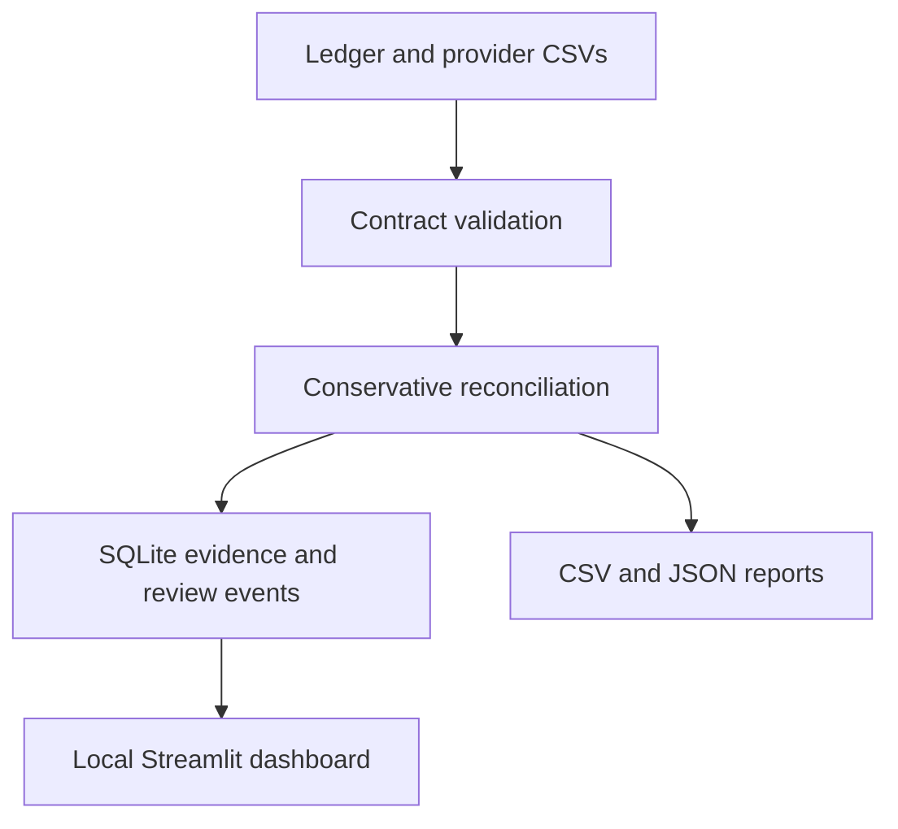

# LedgerLens

**Explainable payment reconciliation with conservative matching and row-level evidence.**

A portfolio project by Jairo Quelal for Data Operations, Data QA and Reconciliation Analyst roles.

> Synthetic demonstration, not a banking product. No real customer data, no money movement, no claim of production deployment.

## The business problem

A company's ledger and its payment provider can disagree. Missing transactions, duplicate references, wrong amounts and delayed posting make spreadsheets difficult to audit. LedgerLens compares both sources and produces an exception queue with the evidence needed to investigate each case.

Example: the ledger records USD 50.00 for `PAY-004`, but the provider reports USD 48.00. LedgerLens flags an amount mismatch and a -200-cent delta. It does **not** assume this is a fee or silently adjust either source.

## Demo results

The included deliberately adversarial dataset contains **12 ledger rows and 9 provider rows**. At the default two-day posting window:

| Result | Findings |
|---|---:|
| Matched pairs | 3 |
| Amount mismatch | 1 |
| Currency mismatch | 1 |
| Date mismatch | 1 |
| Ledger only | 1 |
| Provider only | 1 |
| Manual review | 4 |
| Invalid record | 3 |

These are fixture outcomes, not production performance statistics. Matched and mismatch findings can represent two input rows; single-source, invalid and ambiguous findings represent one. The tests verify that **every input row is represented exactly once**. Ledger row match rate is 3/12 = 25%; it is deliberately low because the fixture targets failure modes.

## Quick start

Python 3.10+; the reconciliation engine uses only the standard library.

```bash
python -m venv .venv
# Windows PowerShell: .venv\Scripts\Activate.ps1
# macOS/Linux: source .venv/bin/activate
python -m pip install -e .
python -m ledgerlens demo --output outputs/demo
python -m unittest discover -s tests -v
```

Outputs: `findings.csv`, `summary.json`, and `audit.sqlite`.

### Optional local dashboard

```bash
python -m pip install -e ".[dashboard]"
streamlit run app.py
```

The dashboard reads SQLite audit runs, filters findings, exports a spreadsheet-safe CSV and records human-review events. Keep it local; it does not implement authentication.

### Reconcile your own files

```bash
python -m ledgerlens reconcile --ledger data/demo/ledger.csv --provider data/demo/provider.csv --max-days 2 --output outputs/custom
```

Both CSVs need these columns:

```csv
record_id,reference,amount,currency,posted_at
L01,PAY-001,100.00,USD,2026-01-01
```

Contract: source-local unique IDs, case-sensitive references, signed decimal amounts with at most two decimal places, USD/EUR/GBP only, ISO dates. Surrounding whitespace is stripped. Amounts are converted to integer cents without binary floating-point arithmetic. Refunds may be negative; zero amounts are permitted. No FX conversion.

### Append a human review

Use the run ID printed by the CLI and a finding ID from the dashboard or SQL query:

```bash
python -m ledgerlens review --db outputs/demo/audit.sqlite --run-id YOUR_RUN_ID --finding-id 1 --reviewer Jairo --decision ESCALATED --note "Synthetic case: source ID appears twice; investigate upstream export"
```

A review is an event, not a reclassification. `RESOLVED_EXTERNALLY` records an operator assertion; it does not verify a correction or recalculate match rates.

## Architecture



## Why this project is useful in an interview

- **Business judgment:** duplicate or invalid-linked references never auto-match.
- **Data QA:** invalid inputs are quarantined, not dropped.
- **Financial correctness:** cents are integers; currencies stay separate.
- **Auditability:** input SHA-256 hashes, engine version and configuration identify a run.
- **Idempotency:** identical source bytes and configuration create one audit run.
- **SQL:** inspect exception queues, currency deltas and review history.
- **Testing:** 11 executable tests covering adversarial cases and row conservation.
- **Human workflow:** explain and escalate exceptions without overwriting source evidence.

## Design boundaries

Matching is one-to-one by exact reference. The date window is inclusive and measured in calendar days. When several mismatches exist, the status prioritizes currency, then amount, then date; the reason retains all violations. No many-to-one settlements, fee modeling, partial refunds, FX or holiday calendars. No fuzzy auto-matching of financial records.

SQLite provides application-level history, not tamper-proof storage. Local users with database write access can modify it. Reviewer names are self-reported. CSV generation is not atomic; the database is the authoritative stored evidence if a report export fails. The engine reads inputs into memory and is not benchmarked for production-scale volumes. Input totals include parse-valid duplicates and are **not** financial exposure or reconciled balances.

## Repository map

| Path | Purpose |
|---|---|
| `ledgerlens/engine.py` | CSV contract, matching, summary, export |
| `ledgerlens/audit.py` | SQLite persistence and review history |
| `ledgerlens/cli.py` | Reproducible command-line execution |
| `ledgerlens/demo.py` | Synthetic fixtures and expected outcomes |
| `app.py` | Optional local dashboard |
| `tests/test_engine.py` | Correctness and audit tests |
| `docs/queries.sql` | Investigation queries |
| `docs/INTERVIEW_ES.md` | Spanish walkthrough and study plan |
| `.github/workflows/ci.yml` | Tests on Python 3.10–3.12 |

## Validation status

The engine and demo were tested locally with 11 passing unittest tests. The dashboard is optional; browser interaction and GitHub Actions results must be checked in the deployment environment. No measured production impact is claimed.
